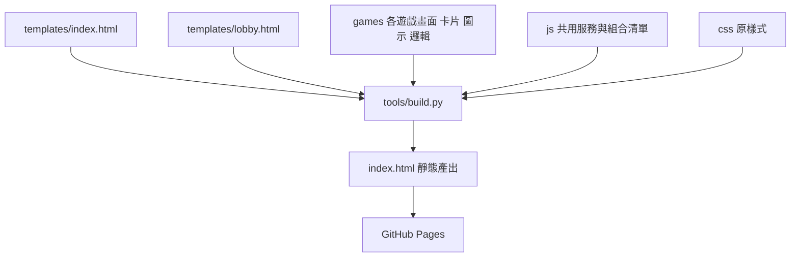

# Deep Sea Arcade：架構與來源定位

## 基準

2026-11-17 將現有單檔實作抽出為可維護來源，組合結果與拆分前 index.html 逐位元組一致。拆分基於工作樹（含 Reaper Shift），不代表已提交或部署。規則／UI／倍率／儲存 Key／GA4 未作行為變更。

## 實際檔案結構

```text
deep-sea-games/
├── AGENTS.md / ARCHITECTURE.md / GAME_RULES.md
├── README.md                 本機操作與新增遊戲指南
├── ANALYTICS.md              GA4 事件與後台設定說明
├── index.html                產生並追蹤的靜態部署檔，勿直接編輯
├── templates/
│   ├── index.html            頁面外殼、選單、view 與 script/style 組合位置
│   └── lobby.html            大廳結構、卡片與 SVG 圖示組合位置
├── css/
│   ├── base.css              原第一段樣式
│   └── arcade.css            原第二段樣式，保留原級聯順序
├── js/
│   ├── analytics.js          獨立追蹤 IIFE
│   ├── config.js             K、時間、最低投入、初始餘額及 STORE 常數
│   ├── wallet.js             原 save/load 儲存函式
│   ├── platform.js           開啟 runtime IIFE、共享狀態 S、工具與 Crash 共用元素
│   ├── controls.js           Crash 輸入與平台重設按鈕
│   ├── navigation.js         大廳篩選、VIEWS、hash 路由
│   ├── bootstrap.js          初始化、宿主 hot 掛鉤、關閉 runtime IIFE
│   └── runtime.js            JS 片段引用順序；本身不是獨立可執行 JS
├── games/
│   ├── catalog.json          遊戲 ID 與檔案路徑索引，不自動註冊遊戲
│   ├── <id>/
│   │   ├── game.js           該遊戲原有邏輯片段
│   │   ├── view.html         該遊戲完整 view
│   │   ├── card.html         該遊戲大廳卡片
│   │   ├── icon.svg          該遊戲 SVG symbol
│   │   └── README.md         自動產生的說明（函式索引、扣款／追蹤位置、規則摘要），勿手改
│   ├── README.md             所有遊戲的索引，同樣自動產生
│   ├── boba/original.html    額外：珍奶原始完整子頁
│   ├── dive/、mrt/           另含 original.html（原始完整子頁）與 style.css（限定該遊戲的平台外框樣式）
│   ├── eat-smaller/、mirror-twins/、shadow-relay/、one-line-defense/  同上，srcdoc 子頁＋style.css
│   └── pancake/original.html 額外：泡麵煎餅子頁（iframe src 載入）與 assets/ 圖片、style.css
├── tools/
│   ├── build.py              Python 標準函式庫靜態組合／檢查
│   ├── test_build.py         組合工具與來源一致性測試
│   ├── game_docs.py          從原始碼產生各遊戲的 README.md（`--check` 檢查是否過期）
│   ├── test_game_docs.py     說明檔新鮮度測試
│   ├── test_blaster.mjs      深海火線行為測試（可選 Node.js）
│   ├── test_frog.mjs         青蛙吃蟲行為測試（可選 Node.js）
│   ├── test_nap.mjs          偷睡大師行為測試（可選 Node.js）
│   ├── test_pudding.mjs      布丁突圍行為測試（可選 Node.js）
│   ├── test_peek.mjs         別看行為測試（可選 Node.js）
│   ├── test_mosquito.mjs     血壓上升行為測試（可選 Node.js）
│   ├── test_banquet.mjs      最後的晚餐行為測試（可選 Node.js）
│   ├── banquet_i18n.py       最後的晚餐六語系字串來源，產生 games/banquet/i18n.js
│   ├── test_mermaid.mjs      人魚接龍行為測試（可選 Node.js）
│   ├── test_tetris.mjs       俄羅斯方塊行為測試（父頁橋接＋子頁流程，可選 Node.js）
│   ├── test_on_pitch.mjs     不准跑調行為測試（免費開局、單次結算、暫停／離頁、英文畫面，可選 Node.js）
│   ├── test_last_hair.mjs    尊嚴保衛戰行為測試（可選 Node.js）
│   ├── test_pet_walk.mjs     小灰出門行為測試（可選 Node.js）
│   └── test_office_shoot.mjs 拒絕加班行為測試（可選 Node.js）
├── dodge-run.html            舊網址 → index.html#runner
├── dream-repair.html         舊網址 → index.html#dream
└── .gitignore                忽略 .claude/、crush-depth.html 與 Python 暫存
```

`.claude/launch.json` 與 crush-depth.html 為既有被忽略的本機檔案，不是可編輯主來源。沒有 package.json、npm 框架、伺服器端模組或 games 以外的隱藏遊戲框架。

## 大廳排行榜與後端

`js/member.js` 用 `frontend/services/api.mjs` 查詢所選遊戲的 D1 前 50 筆最佳紀錄，並重用原本的玩家、遊戲、最佳紀錄表格。會員中心和錢包繼續讀取原有的本機資料。青蛙吃蟲用雲端訪客 ID 保存排行榜分數，前端與 Worker 共用 `shared/frog-rules.cjs` 的玩法判定。D1 在同次寫入保存已驗證訪客回合，更新 `game_leaderboard` 的公開前 50 名。`player_best_scores` 保留給日後有登入的帳戶。Worker 入口、D1 migrations 與部署設定位於 `backend/`，API 契約位於 `shared/api.mjs`。見 [後端開發](docs/BACKEND.md)。

## 組合方式與責任邊界

`python3 tools/build.py` 從 templates/index.html 遞迴展開 `{{include:專案相對路徑}}`，不自動加換行或改寫程式。`{{json:games/<id>/original.html}}`（boba、dive、mrt）將子頁序列化為 JSON 並跳脫 `<`，保留原 srcdoc 橋接流程。相對路徑皆從專案根目錄解析；工具拒絕循環引用與越界路徑。`--check` 不寫檔，檢查產出與遊戲 catalog 是否一致。

這次是「來源拆分」，不是把所有遊戲改成獨立 ES module。JS 片段仍在部署產出中構成原本一個共享 IIFE，順序由 js/runtime.js 決定。不要把 platform.js 或 bootstrap.js 單獨加為 script，單一片段也不一定能獨立通過語法解析；應解析組合後的 game-runtime。



### 實際共享相依

- S 在 js/platform.js 初始化，仍同時保存 Crash 狀態與共用餘額；js/wallet.js 僅抽出 save/load，未宣稱錢包已完全獨立。
- games/crash/game.js 中的 renderAll／renderGo 等仍被其他遊戲使用；js/platform.js 的 rollCrash 同時供 Crash 與 Limbo 使用。各遊戲可直接引用共享 `$`、C、MIN_BET、S、AN 等。
- 原有各遊戲的 syncBalance 等函式保留在原遊戲區段，沒有為統一介面而改寫。
- js/bootstrap.js 依原有順序初始化各款遊戲；js/controls.js 的重設防護及 hot.snapshot 仍逐款列舉。新增遊戲必須核對這些接點。
- js/analytics.js 保持獨立 IIFE，runtime 使用 AN；目前沒有新建 wallet class、事件匯流排或自動註冊框架。

### 遊戲路徑與狀態識別字

| games/ 子目錄（亦為 hash） | 主要定位 |
| --- | --- |
| crash | S、placeBet、cashOut、doCrash、frame |
| mines / plinko / merge | M / P / G |
| dice / limbo / hilo | D / L / HL |
| keno / wheel / tower / crossing | KE / WL / TW / CR |
| dream / elevator / fishing / campaign / reaper / blaster | DR / EQ / FI / CP / RP / BL |
| runner / sneak / cat / bird / frog / nap / clock-out / pudding / peek / mosquito / last-hair / pet-walk / office-shoot / banquet / mermaid | runnerBusy / sneakBusy / catBusy / birdBusy / frogBusy / napBusy / clockBusy / puddingBusy / peekBusy / mqBusy / hairBusy / petBusy / otBusy / bqBusy / mmBusy，各自內層 IIFE（last-hair 即尊嚴保衛戰）|
| carp / rider / boss / thief / baby | carpBusy / riderBusy / bossBusy / thiefBusy / babyBusy，各自內層 IIFE（由獨立頁面改編，共用 G 物件與造型解鎖流程）|
| boba | BOBA、deepSeaBoba；original.html 為子頁 |
| dive | DIVE、deepSeaDive；original.html 為子頁（一口氣探險） |
| mrt | MRT、deepSeaMrt；original.html 為子頁（捷運搶位） |
| eat-smaller / mirror-twins / shadow-relay | EATS／deepSeaEatSmaller、MIRR／deepSeaMirrorTwins、SHAD／deepSeaShadowRelay；original.html 為子頁（數字吞噬／鏡像雙子／影子接力，關卡制，一局內每關首通 +2 點） |
| one-line-defense | ONEL、deepSeaOneLine；original.html 為子頁（一筆畫守城，每撐過 30 秒 +2 點） |
| tetris | TET、deepSeaTetris；original.html 為 srcdoc 子頁（俄羅斯方塊，免費、無 BONUS，成績不換點數） |
| on-pitch | OP（內部狀態在 game.js 自己的 IIFE 內）、deepSeaOnPitch；畫面直接用 `#op-canvas`（400×720），不使用 iframe。免費、無 BONUS，成績不換點數；麥克風音高偵測（YIN）核心 `createGame` 為純邏輯 |
| quack-pond | QP、deepSeaQuackPond；200 關邏輯謎題（呱呱池塘），免費、無 BONUS |
| pancake | PANCAKE、deepSeaPancake；original.html 為以 iframe src 載入的子頁，圖片在 assets/ |

### 隱藏遊戲

`games/catalog.json` 的 `"hidden": true` 讓 `tools/build.py` 在組合時替該遊戲的大廳卡片加上 `hidden data-game-hidden`、替選單連結加上 `hidden`。遊戲的 view 與邏輯仍照常組合與初始化（共用執行環境會逐款初始化，直接移除 view 會造成錯誤），只是看不到也開不了：`js/navigation.js` 的 route 遇到被隱藏的 hash 會回大廳並以 replaceState 修正網址；大廳篩選與數量由頁面上實際顯示的卡片即時計算，沒有遊戲的分類按鈕會自動隱藏。重新顯示只需移除該遊戲的 `hidden`、重新組合。

### 路由與珍奶橋接

js/navigation.js 的 route 以 hash 切換 view 與 tab、標題、AN.view，空白／未知 hash 回 #lobby；保留大廳捲動位置及左上返回。各遊戲暫停方式不同，沒有新增統一暫停行為。

games/pancake/game.js 首次進入時把 iframe `src` 設為 `games/pancake/original.html`（同源，圖片以相對路徑載入）。deepSeaPancake 提供 balance、start、spend、finish、progress、pause、resume、touch，同樣驗證來源 contentWindow；子頁提供 setPancakePlatformActive（切走時暫停）、finishPancakePlatformRound。iframe 帶 `allow="accelerometer; gyroscope; magnetometer"` 供晃手機玩法使用。

games/boba/game.js 首次進入時從產出的 boba-source JSON 設定 iframe.srcdoc。deepSeaBoba 提供 start、finish、progress、pause、resume、touch，以及排行榜用的 rules（shared/boba-rules.cjs）、prepare、advance、record，驗證來源 contentWindow；子頁提供 setBobaPlatformActive、finishBobaPlatformRound。原粉色 UI、父頁扣點／GA4、子頁本機紀錄責任維持原狀。

一口氣探險（dive）與捷運搶位（mrt）沿用相同 srcdoc 子頁模式，但 view 採用與其他遊戲相同的 `.console` 版型（左側 iframe、右側 `.side .panel` 放固定 10 點入場、目前分數／階數、最佳紀錄與扣點按鈕）。右側按鈕呼叫子頁的 `startDivePlatformRound`／`startMrtPlatformRound`，與子頁開場按鈕共用同一開局流程；開局時呼叫 `deepSeaDive.start`／`deepSeaMrt.start` 由父頁驗證來源、檢查餘額並扣 `ENTRY_FEE`（回傳 0 代表未扣款），結束時以 `finish` 回報倍率，由父頁計算 `floor(入場 × round(倍率×100) / 100)` 並入帳，`active` 旗標保證單次扣款與單次結算。兩者另提供 `live`（只更新右側面板倍率）、`progress`、`touch`；mrt 另有 `pause`／`resume`。父頁經 `setDivePlatformActive`／`setMrtPlatformActive` 通知子頁是否顯示：隱藏時停止繪圖，mrt 在進站中會自動暫停。子頁單獨開啟（無父頁）時維持原本不扣點的示範模式。原始子頁中未使用的示範錢包（`lobbyPoints`）已移除，子頁不保存點數。

## 資料與錢包

預設餘額 `START_BALANCE=500`，踩地雷、打磚塊、Ocean Link 與每日挖礦等免費遊戲不扣點，付費遊戲依入場說明扣 `ENTRY_FEE=10`（js/config.js；餘額不足提示統一用 `LOW_MSG`），共用最低投入 `MIN_BET=10` 仍供隱藏的機率遊戲使用。餘額低於 `REGEN_CAP=100` 時，js/wallet.js 的 `regenTick` 每分鐘加 1 點（`REGEN_MS`），以牆上時鐘計算，含頁面關閉期間；`regenStart` 在 bootstrap 啟動 1 秒計時與回到分頁時的補算。讀取餘額以 parseInt 並檢查有限且非負；各投入欄位的讀取／取整方式並非完全一致，修改時應核對對應函式。

| localStorage Key | 用途 |
| --- | --- |
| `crush-depth-balance` | 共用餘額字串 |
| `deep-sea-regen-at` | 回點計時的起點（毫秒時間戳）；新增於 2026-11-17，缺少時以載入當下起算，不補發舊資料 |
| `deep-sea-mines-best` | 踩地雷最多翻開安全格（0～22）；缺少或無效時以0起算 |
| `deep-sea-gold-daily-v1` | 台灣日期、每日次數、已發點數及本次layout／open；沒有舊資料時初始化，不修改舊Key |
| `deep-sea-mines-level-best` | 舊版通關紀錄，保留不再更新 |
| `deep-sea-breakout-best` | 打磚塊最佳分數；缺少或無效時以0起算 |
| `deep-sea-breakout-level-best` | 打磚塊最高關卡；缺少或無效時以0起算 |
| `deep-sea-gold-best` | 挖金礦最佳分數；缺少或無效時以0起算 |
| `pearl-merge-best` | 合併最佳分數 |
| `chayne` | Dodge Run 最佳距離 |
| `deep-sea-queue-best` | Queue Cutter 最多累積超越乘客數 |
| `sneak` | Sneak 最多完成關卡 |
| `deep-sea-fishing-best` | 最多釣獲條數 |
| `deep-sea-campaign-best` | 選戰最佳票數 |
| `deep-sea-cat-best` | Rooftop Cat 最佳顯示距離 |
| `deep-sea-bird-best` | Poop Bird 最佳顯示距離 |
| `deep-sea-frog-best` | 青蛙吃蟲最多吃掉隻數；新增於 2026-11-17 |
| `deep-sea-pudding-best` | 布丁突圍最高分數；新增於 2026-11-17 |
| `deep-sea-clock-out-best` | 下班保衛戰最高分；新增於 2026-11-17 |
| `deep-sea-peek-best` | 別看最佳進度（百分比整數）；新增於 2026-11-17 |
| `deep-sea-peek-deaths` | 別看各死因次數（JSON 物件）；新增於 2026-11-17 |
| `deep-sea-peek-dodges` | 別看累計躲過襲擊次數（整數）；新增於 2026-11-18 |
| `deep-sea-last-hair-best` / `-deaths` / `-swap` / `-sound` | 尊嚴保衛戰最遠距離、最近死亡位置與原因、左右手對調、音效開關；新增於 2026-11-17 |
| `deep-sea-banquet-best` | 最後的晚餐贏局次數；新增於 2026-11-18 |
| `deep-sea-banquet-lang` | 最後的晚餐遊戲內語言（en／es／de／ja／ko／zh，預設 en）；新增於 2026-11-19 |
| `deep-sea-banquet-adv` / `deep-sea-banquet-mute` | 最後的晚餐「進階模式」與「靜音」開關（1／0）；新增於 2026-11-18 |
| `deep-sea-book-sort-best` | 貓咪疊書舖各編號關卡最少步數（JSON：關卡編號 → 步數）；新增於 2026-11-19 |
| `deep-sea-mermaid-best` | 人魚接龍（JSON：`best` 依難度 1／2／4 的最高分、`mode` 上次選的難度）；新增於 2026-11-18 |
| `deep-sea-mosquito-best` | 血壓上升最高吸血百分比（一位小數）；新增於 2026-11-17 |
| `deep-sea-pet-walk-save` | 小灰出門存檔（JSON：最高分、出門次數、物資、事件與物資圖鑑、上次事件）；新增於 2026-11-17 |
| `deep-sea-office-shoot-best` | 拒絕加班最佳績效（整數）；新增於 2026-11-18 |
| `deep-sea-nap-best` | 偷睡大師最高分；新增於 2026-11-17 |
| `reaper` | Reaper 最佳正常靈魂處理總數 |
| `deep-sea-blaster-best` | 深海火線最佳通關數（無關卡上限，沿用既有數值格式） |
| `deep-sea-carp-best` / `deep-sea-carp-skin` | 鯉魚躍龍門 最佳紀錄／已選造型編號 |
| `deep-sea-rider-best` / `deep-sea-rider-skin` | 外送員大戰惡犬 最佳紀錄／已選造型編號 |
| `deep-sea-boss-best` / `deep-sea-boss-skin` | 胖老闆追人 最佳紀錄／已選造型編號 |
| `deep-sea-thief-best` / `deep-sea-thief-skin` | 偷水果的貓 最佳紀錄／已選造型編號 |
| `deep-sea-baby-best` / `deep-sea-baby-skin` | 寶寶逃洗澡 最佳紀錄／已選造型編號 |
| `straw_game_events` | 珍奶本機事件紀錄，上限 5,000 筆 |
| `straw_game_player_id` | 珍奶本機玩家識別值 |
| `straw_game_best` | 珍奶最佳杯數 |
| `straw_game_last_open` | 珍奶最後開啟時間 |
| `straw_game_today` | 珍奶當日紀錄 `{d,n}` |
| `diveBestScore` | 一口氣探險最佳分數（子頁寫入，同源；舊 `diveBestMult` 保留不讀） |
| `mrtBestTier` | 捷運搶位最佳階數（子頁寫入，同源；舊 `mrtBestMult` 保留不讀） |
| `eatSmaller.unlocked` / `eatSmaller.bests` | 數字吞噬已解鎖關數、每關最佳秒數（JSON，子頁寫入）；新增於 2026-11-18，沿用原版 Key |
| `mirrorTwins.unlocked` / `mirrorTwins.stars` | 鏡像雙子已解鎖關數、每關最佳星等（JSON，子頁寫入）；新增於 2026-11-18 |
| `shadowRelay.unlocked` / `shadowRelay.bests` | 影子接力已解鎖關數、每關最佳秒數（JSON，子頁寫入）；新增於 2026-11-18 |
| `tetris-best` | 俄羅斯方塊最高分（整數字串，子頁寫入）；新增於 2026-11-19 |
| `tetris-ctl` | 俄羅斯方塊手機操作模式（`gesture` 或 `buttons`，子頁寫入）；新增於 2026-11-19 |
| `on-pitch-v1` | 不准跑調存檔（JSON：`stars` 各關最高星數、`input` 為 `mic` 或 `key`、`octave` 為 `any` 或 `strict`）；新增於 2026-11-19 |
| `qp_progress` | 呱呱池塘進度（`{max,stars}` JSON，各關最高星數；子頁寫入）；新增於 2026-11-19 |
| `qp_level` | 呱呱池塘當前關卡（整數，子頁寫入）；新增於 2026-11-19 |
| `qp_lang` | 呱呱池塘語言偏好（子頁寫入）；新增於 2026-11-19 |
| `qp_seen` | 呱呱池塘已看過教學（子頁寫入）；新增於 2026-11-19 |
| `qp_muted` | 呱呱池塘靜音設定（子頁寫入）；新增於 2026-11-19 |
| `qp_best_*` | 呱呱池塘各關最佳用時（子頁寫入）；新增於 2026-11-19 |
| `oneLine.best` / `oneLine.tutDone` | 一筆畫守城最佳分數、教學已完成（JSON，子頁寫入）；新增於 2026-11-18 |
| `ticatica-sidebar-collapsed` | 大廳左側選單是否收合（1／0），只影響畫面；新增於 2026-11-18，缺少時展開 |
| `deep-sea-free-until` | 泡麵煎餅看示範廣告後的免扣點截止時間（毫秒時間戳）；新增於 2026-11-17，只有泡麵煎餅讀取 |
| `noodle_pancake_events` | 泡麵煎餅本機事件紀錄，上限 3,000 筆 |
| `mini_player_id` | 泡麵煎餅（及之後的小遊戲）本機玩家識別值，不送 GA4 |
| `noodle_pancake_calib` / `noodle_pancake_daily` / `noodle_pancake_last_open` / `noodle_pancake_next_clicks` | 泡麵煎餅的動作感應校準、當日局數、最後開啟時間、「想玩第 2 晚」點擊數 |

大部分回合只存在記憶體；重新整理不會還原進行中的遊戲，已扣餘額仍保存。這是瀏覽器本機錢包，沒有伺服器帳戶、跨裝置同步或付款系統。

測試用重設按鈕直接設為 `START_BALANCE`（500）點並發送 points_reset。現有進行中防護檢查多個遊戲，但未涵蓋 `G.active`（Merge）與 `CP.active`（Campaign）；這是核對到的現況缺口，本次沒有修正，不能聲稱所有遊戲中都禁止重設。

## GA4 契約

實際使用直接 Google tag，評估 ID `G-B5PKZSCCEQ`，不是另載入 `GTM-THMM5HVQ`。`window.deepSeaAnalytics` 由頂部 IIFE 建立，runtime 以 `AN` 呼叫。完整操作參考 [ANALYTICS.md](ANALYTICS.md)。

- 事件：`lobby_view`、`game_view`、`game_start`、`game_resume`、`game_progress`、`game_active_time`、`game_end`、`points_reset`。
- 共用識別：`send_to`、`game_id`、`game_name`、`app_version='analytics-v1'`；回合使用隨機 round_id。
- 開始投入欄位是 `entry_points`；結束使用 `stake_points`、`payout_points`、`net_points`、`round_active_seconds`、`round_elapsed_seconds`。progress 保留 stage、step、checkpoint 等欄位。
- end 後移除回合，避免二次結束；結果包含 cashout、loss、complete、cancelled、restart、abandoned。
- 有效時間只計算目前可見、聚焦、遊玩中的遊戲；閒置 60 秒停止累計，約每 15 秒及切換／結束／失焦時送出 active_seconds。關卡選擇停留不計；同款多顆 Plinko 的遊戲總時間不重複累計。
- 正常 pagehide 對未完成回合標記 abandoned；BFCache 的 persisted 情況走暫停／恢復。
- localhost、127.0.0.1、[::1] 與 file 協定不送出追蹤；正式環境可用 `?analytics_debug=1` 啟用 debug_mode。關閉 Google signals 與廣告個人化訊號。
- 珍奶本機 player_id 不應被新增為 GA4 個人識別參數。此次未驗證 GA4 後台收件或自訂維度設定。

## 執行與部署相依

可用 Python 靜態伺服器在專案根目錄執行 `python3 -m http.server 8765`，以 HTTP 開啟 index.html。無 npm 安裝；修改來源後先執行 `python3 tools/build.py` 產生靜態 index.html，GitHub Pages 本身不需要執行 Python。部署保持 GitHub Pages 專案子路徑相容；本次沒有據未檢視的遠端設定推定部署工作流程。

瀏覽器相依包含 DOM、Canvas 2D、SVG、localStorage、requestAnimationFrame、Pointer／Keyboard 事件等。ResizeObserver、減少動態效果偏好與音效等已有對應偵測／處理。外部資源主要為 Google Fonts（Chakra Petch、Noto Sans TC）及 Google Analytics；核心遊戲沒有框架、ES module 套件或後端 API 相依。珍奶另使用可選 Web Audio、分享／剪貼簿能力及其替代流程。

## 後續演進

目前每款遊戲已能分開定位，通常不必讀取產出的 index.html。若日後共享相依持續增加，再另提方案建立明確錢包／遊戲註冊 API、逐款遷移並做行為測試；此次沒有進行該第二次重構，也沒有變更規則。完整新增遊戲流程見 [README.md](README.md)。

## 手機頁面導覽

`css/mobile-navigation.css`、`templates/mobile-navigation.html` 與 `js/mobile-navigation.js` 提供880px以下的精簡遊戲頁首及合併工具列。頁首只顯示中文遊戲名、首頁入口與點數，英文副標／Demo／回點說明在遊戲頁隱藏（大廳仍顯示）；重設功能保留。工具列合併「切換遊戲、畫面、操作」，不另占第三排，不擠窄畫布；已移除固定側邊滑軌。

畫布與操作面板之間插入低調的 native pan-y 捲動區；iframe遊戲則放在父頁的frame區塊之後，不改珍奶或其他子頁原畫面。也可在置頂工具列上滑動捲頁。這些區域沒有pointer／touch阻擋事件，遊戲內手勢保持原狀。跳轉只捲動目前view，遵守減少動態效果偏好，不改hash／點數／遊戲狀態。桌面與大廳不顯示手機導覽。

### 手機畫面內開始按鈕

`js/mobile-stage-actions.js` 在880px以下將原有 `.side button.go` 移到遊戲畫面內，保留原 DOM 節點、id、click listener、disabled／hidden 與扣點／追蹤流程，不建立代理扣款按鈕。以註解節點記住原位置；進行中操作（surface／cancel或disabled）回原位置，待機／關後／死亡可操作按鈕顯示於畫面內。MutationObserver只觀察原按鈕狀態，沒有輪詢、沒有觸發click；回桌面即復位。遊戲中浮層收起，僅按鈕本身接收事件，不蓋住畫布觸控。原本畫面內已有開始按鈕的iframe遊戲維持不變。

## 蓋樓大師（skybuilder）

`games/skybuilder/` 是 TowerBuilding.html 的繁中整合，沿用共享 IIFE、錢包與追蹤。`sbBusy` 防止遊玩中重設；每局固定10點，10／20／30層各即時送固定5點BONUS，結束不重複入帳。最佳樓層使用新增的 `deep-sea-skybuilder-best`，不修改既有資料鍵；缺少時以0起算，回復程式時可保留此鍵。

## 踩地雷與每日挖金礦

踩地雷為免費懷舊遊戲，開局與重玩皆不扣點、不限次數；M.active表示進行中，重設防護不變。低中高預設或自訂2～10邊長與1～N×N−1顆雷，每局固定設定。deep-sea-mines-level-best保留舊關卡紀錄，不再更新；舊deep-sea-mines-best保持第一關安全格紀錄。挖礦不再扣點，新增deep-sea-gold-daily-v1保存當日配額與剩餘格子，舊deep-sea-gold-best保持分數格式。新Key獨立，缺少時初始化，不遷移或清除玩家餘額；回復來源時可保留新Key，舊版忽略。每日補給卡片放在右下角固定daily-supply浮動圖示，正常lobby-grid計數與篩選不包含它。

KE.active涵蓋免費挖掘，使用現有syncBalance／save入帳；可用時以Web Locks序列化跨分頁操作，刷新及其他分頁先讀配額與已挖格子防止重複發點。儲存消耗先於入帳，非資料庫原子交易；突然關閉可能少發一次，不能宣稱強一致或防作弊。台灣日期變更後舊回合到期。正常pagehide以捕獲階段先送含已發點數的abandoned，BFCache不提前結束。其他遊戲與錢包Key不變。

## 中英文顯示與語言切換

`templates/index.html` 的頁首提供「繁中／EN」。`locales/en.json` 保存英文翻譯，透過 JSON script 組合進部署產出；`js/i18n.js` 在原本的 game-runtime 前初始化，維持原有 runtime 片段順序與 IIFE。`css/i18n.css` 處理較長的英文、重複英文副標及手機頁首。

預設繁體中文；`?lang=en` 或 `?lang=zh-Hant` 優先於已儲存偏好。切換只以 replaceState 更新語言參數，保留其他 query 與目前 hash，不呼叫 route、開始／結束回合或 GA4。新 Key `deep-sea-language-v1` 僅保存 `en`／`zh-Hant`，不遷移、清除或改寫舊的點數／紀錄 Key。偏好儲存受限時仍可在目前頁面切換。

翻譯只作用於顯示層：保留原文字的 WeakMap、監看新增／更新的文字及 aria-label／title／placeholder／alt，跳過 script、style、noscript 與 data-i18n-ignore。以原文字重新翻譯或還原，不將英文再反向猜成中文，不替換 DOM 按鈕、不修改 input 值。Canvas 的 fillText／strokeText／measureText 在繪製邊界翻譯，英文繪製依現有 transform、對齊與 maxWidth 限制寬度；遊戲內的文字常數、狀態、判定與 GA4 名稱不翻譯。`js/mobile-stage-actions.js` 用 sourceText 讀原按鈕文字，保留續關／重玩放置的既有判定。珍奶 iframe 原本已是英文，保留其原始 HTML、橋接與暫停流程。

修改介面文字時須同步 `locales/en.json`；`tools/test_i18n.py` 檢查來源字串與翻譯覆蓋、英文值及 JSON script 安全。可用 `python3 tools/check_i18n_browser.py` 在獨立暫存 Chrome 設定檔驗證語言、資料與遊戲操作；以裝置模擬設定實際 CSS 寬度，不把視窗截圖寬度當成手機 viewport 的證據。

## 時序修復與深海火線更新（2026-11-17）

時序修復為固定入場10點、無限關卡的停針挑戰，沒有點數獎勵或領回。drDifficulty限制目標寬度與速度，drAdvance管理預告反轉及暫停；第11關起最多一次、第21關起最多兩次。保留既有狀態與ID，不新增儲存Key。hot.snapshot不將本局入場費加回餘額；每局單次扣款與start，過關progress、續關resume、失敗end且payout_points=0。

深海火線（2026-11-17 玩法大改）：改為自由左右移動（BL.target／BL.keys，拖曳、按住按鈕與鍵盤；移除三條航道）；武器為「形態」BL.form（7 種），每累計 36 波暫停彈出三選一（BL.picks／BL.sinceCard，phase 'pick'，不計時、不扣款、離頁記 abandoned），開局固定脈衝彈、不再有掉落的武器箱；火力等級只在過關與王戰 +1。出怪改為隨進度漸增的每波怪數（blWavePlan，5 個欄位 1～5 隻），一關約 3 倍長（54 波起），新增水雷、礁石、噴墨烏賊與每5關的深海巨獸（BL.ink）；不新增儲存Key，扣點、重玩費、里程碑與GA4生命週期不變。數值與公式見 GAME_RULES.md 第22節。tools/test_blaster.mjs 為 Node 行為測試。

## Ocean Link

`#ocean-link` 透過 `games/ocean-link/view.html`、`style.css`、`card.html` 與 `icon.svg` 接入靜態組合，列於免費懷舊分類。點擊遊戲區會啟用全螢幕並免費開局。`game.js` 在共用 runtime 內管理畫面、遠征、錢包及追蹤，並在其閉包內組合 `board.js`（關卡設定、路徑、移動與保證可解的發牌）及 `tiles.js`（64 種圖案）。全螢幕使用 Fullscreen API，若無法啟用則使用有安全區邊距的固定版面。新增 `deep-sea-ocean-link-best-v1`，以 JSON 物件分開記錄簡單、標準與挑戰的最高通關關卡；共用餘額沿用既有儲存。

## 荒島遠征（frontier）

`games/frontier/game.js` 在共享 runtime 內建立獨立閉包，組合純模擬 `world.js` 與 Canvas `draw.js`。後者依攝影機裁剪資源並按腳底 y 排序。`frontierRoute` 管離頁暫停，已有 start/progress/resume/end 防重複結算。`view.html` 的手機全螢幕包含背包、金幣、交易與裝備抽屜；原生 Fullscreen API 失敗時用 `.ft-immersive` 固定全視窗，離開路由時退出。手機搖桿與點地面前往並存，採集／建造／攻擊／拾幣／卸貨／修復自動執行；跨河自動行走經橋樑。

`world.js` 管50關逐區擴張、實體採集搬運工人、金幣／買賣／裝備、箭塔、敵營與敵襲。遊戲金幣不讀寫平台餘額。沿用 `deep-sea-frontier-v1`，保留舊paid資格與cleared，載入62點／6建築舊存檔時先驗證再以 `frontierMigrate` 補上新欄位與資源／建築；材料、位置、裝備與進度保留。異常解析不清除原資料。增大陣列後退版不保證舊loader可讀，回復應保留存檔副本。不是跨分頁交易或伺服器帳戶。美術入口為 `games/frontier/AGENTS.md`、`ART_DIRECTION.md` 與 `art/direction-board.png`；設定圖也附於遊戲規則下方，與Canvas實際畫面區分。參數與限制見GAME_RULES第46節。

## 免費平台、遊玩獎勵與紙娃娃（2026-11-18）

ENTRY_FEE=0，已上架遊戲移除扣款，iframe以開局成功布林值通訊，不再以正金額判斷成功。js/wallet.js保留舊STORE與回點時間鍵，停用自然回點；玩家餘額不重設。platform/wardrobe.js放在導航前、同一runtime IIFE內，bootstrap讀取餘額後初始化。大廳details與頁首入口呈現平台角色，三槽帽／服裝／跟隨配件不接入遊戲能力。

AN.tick只在原有可見聚焦且engaged的有效時間呼叫deepSeaProgress.active一次；end以有效時間與結果呼叫complete。新Key deep-sea-wardrobe-v1含version、owned、equipped、day、playMs、playPaid、completed；合法舊錢包原樣讀取，沒有原資料遷移。收藏寫入失敗不扣款；損壞收藏不清除，顯示錯誤。兌換與平台獎勵使用單頁queue，支援時加Web Locks，操作前重讀配額與餘額，避免連點重發／重扣；claim／收藏與wallet為兩個localStorage鍵，不宣稱交易原子性或防作弊，異常關機仍可能少發獎勵或少扣一次兌換費。回復本版只回復來源並重建，保留新Key，舊版忽略。

## 全體點數歸零（2026-11-18 一次性）

依使用者指示，所有玩家的共用餘額 `crush-depth-balance` 在載入時一次性歸零：`deep-sea-balance-zero-v1` 標記尚未為 `1` 時，將餘額設為 0 並寫入標記，之後照常讀取（歸零後賺到的點數會保留，不會再歸零）。造型收藏 `deep-sea-wardrobe-v1` 不受影響。頁首第一次畫面的預載腳本也依標記顯示，不會先閃出舊點數。回復方式：移除 `js/wallet.js` 的歸零區塊（已歸零的點數無法恢復）。測試：`node tools/test_balance_zero.mjs`。

## Frontier art and immersive HUD update

Frontier draw.js uses two PNG atlases with vector fallback. Optional world.supplies is added by migration without replacing saved materials. The model handles source-debit-first resource pickup, worker hauling, building bonuses and equipment limits; rendering does not award resources. Handheld start/resume requests fullscreen and landscape; unsupported orientation lock uses a pause-and-rotate prompt. The frontier-immersive document class hides platform navigation only during this game's immersive session and is cleared on exit. Profile/wardrobe entry controls are temporarily hidden; data, rewards and storage keys remain intact.

### 收盤之前

`games/market-desk/` 的雙語案件由 `cases.js` 組合進遊戲邏輯。手動點選推進交易日，切換分頁保留當前狀態，路由離開時結束當局。專用儲存鍵 `deep-sea-market-desk-best` 保存結局確認時的最高查證分數（0～100），共用錢包無遊戲交易。

貓咪疊書舖以 `shared/book-sort-rules.cjs` 共用編號盤面與搬書判定。全視窗遊戲右上選單接入既有訪客回合 SDK，由 Worker 驗證後更新訪客排行榜。

分享成績由 `js/result-share.js`（按鈕、截圖、回合狀態）、`frontend/services/share.mjs` 與 `share-card.mjs`（成績卡與對話框）、`shared/share-games.mjs`（各遊戲設定）及 API Worker 的 `backend/src/services/shares.mjs` 組成；主站 `site/worker.mjs` 只把 `/s/*` 轉給 API Worker。除挖金礦外所有可見遊戲皆已接入。詳見 [docs/BACKEND.md](docs/BACKEND.md#分享成績連結)。

Telegram Bot 是獨立的 Worker，放在 `telegram-bot/`（已列入 `.assetsignore`，不會當成網站檔案發布）。它只回覆 `/start`、`/play`、`/random`、`/daily`、`/leaderboard`、`/help` 的文字與開啟網站的按鈕，不讀寫 D1、錢包、排行榜或 GA4。設定步驟見 [telegram-bot/README.md](telegram-bot/README.md)。

### 深海前哨

`games/outpost/` 用 DOM 顯示三路棋盤與觸控部署。前端與 Worker 共用 `shared/outpost-rules.cjs`，每 10 ms 推進一次，僅記錄有效部署與閘門換道。背景、失焦及離開 hash 時暫停，返回手動繼續。最佳分數使用獨立鍵 `deep-sea-outpost-best-v1`。

訪客沿用 `POST /api/v1/boards/rounds` 及 `POST /api/v1/boards/rounds/move`。Worker 驗證訪客、revision、兩小時有效期限、經過時間、規則版本及合法終點，再用操作重播計分。沿用既有 D1 migration 與公開榜 trigger。新部署按 Worker、前端順序，回退時移除此次前端接線並重新組合、還原 Worker 的遊戲註冊，保留訪客歷史資料。

遊戲路由使用 `is-game` 隱藏共用的遊戲切換與畫面／操作工具列，提供精簡返回大廳連結。荒島遠征和深海連連看的返回入口放在遊戲內工具列，手機自動進入沉浸版面時仍可使用；深海火線、貓咪疊書舖與深海前哨使用各自的返回入口。

深海前哨第二至第三十關共用同一模擬（第 4–30 關由 `outpost-rules.cjs` 內固定種子的產生器建立），解鎖進度另存 `deep-sea-outpost-unlocked-v1`。訪客排行榜的重播入口固定開第一關，舊成績仍使用同一套分數規則。其餘 29 關進度存於瀏覽器，沒有新增 D1 migration。

《深海火線》的航行、碰撞、選卡和距離計算位於 `shared/blaster-rules.cjs`，同一規則由前端及排名 Worker 執行。前端以 `games/blaster/game.js` 接入畫布、點數和既有訪客 SDK。排行榜使用整數公尺，顯示於遊戲畫面內。

### 百萬大學堂（academy）

`games/academy/` 為原生 view（手機全螢幕、桌面置中手機比例），不用 iframe。`i18n.js` 放三語題庫與介面文字（站台翻譯器略過 `data-i18n-ignore`），`shared/academy-rules.cjs` 是前端與 Worker 共用的純狀態機。排行榜、BONUS 與儲存 Key 見 GAME_RULES.md 對應章節。
